# Online Softmax & FlashAttention

> **Loop fusion for attention** — learn how “online” (single-pass) algorithms turn multi-scan math into one streaming update, then apply that idea to **safe softmax** and **FlashAttention**.

All diagrams: [`assert/`](https://github.com/Gaurav14cs17/DSA/tree/main/41_loop_fusion_online/00_online_softmax_flashAtten/assert)

> **GitHub math tip:** display math uses fenced `math` code blocks. Inline math with subscripts uses the `$` + backtick form so Markdown does not eat `_`.

---

## Why this matters

Standard softmax / attention needs **several full passes** over the sequence (find max → sum exps → normalize → multiply by V). Each pass burns memory bandwidth.

An **online algorithm** keeps only a tiny **running state**. When a new value $`x_i`$ arrives, it applies a **correction factor** and updates that state — no re-read of past data.

```text
  state(i-1)  +  x_i  +  correction  →  state(i)
```

Path: **Basics (what you need first)** → warm-ups → matrix accumulation → Online Softmax → FlashAttention.

---

## Roadmap

```text
  ⓪ Basics required
         │
         ▼
  Warm-ups                         Bridge                      Softmax → Attention
 ─────────                       ────────                    ───────────────────
  ① Running average      ──┐
  ② Welford variance     ──┤
  ③ Kadane max-subarray  ──┼──►  ⑤ Matrix accumulation  ──►  ⑥ Online softmax  ──►  ⑦ FlashAttention
  ④ Top-2 maximum        ──┘      (O ← O + contribution)       (fuse max + d)         (fuse m, d', o')
```

| Stage | Topic | Goal |
|-------|--------|------|
| **Basics** | [⓪ Basics required](#0-basics-required--before-you-start) | Offline vs online, state, invariant, correction, safe softmax |
| **Warm-up** | [① Running average](#1-running-average-cumulative-mean) | Learn the basic online update: old state + correction |
| **Warm-up** | [② Welford variance](#2-welfords-online-variance) | Correct a dependent state when another statistic moves |
| **Warm-up** | [③ Kadane](#3-maximum-subarray-sum--kadanes-algorithm) | Keep two coupled running values (local + global) |
| **Warm-up** | [④ Top-2 max](#4-first--second-maximum-in-one-pass) | Maintain a running max and react when it changes |
| **Bridge** | [⑤ Matrix accumulation](#5-matrix-accumulation-online-output) | Build $`O`$ online: $`O_i = O_{i-1} + A_i B`$ |
| **Core** | [⑥ Online safe softmax](#6-online-safe-softmax) | Fuse find-max + denominator into one pass |
| **Goal** | [⑦ FlashAttention](#7-flashattention--fusing-softmax-and-av) | Fuse softmax and $`AV`$ into one streaming update |

---

## 0. Basics Required — Before You Start

If someone is learning **running / online algorithms** (and later FlashAttention), these are the basics they need first. Without them, the update formulas look like magic.

<p align="center">
  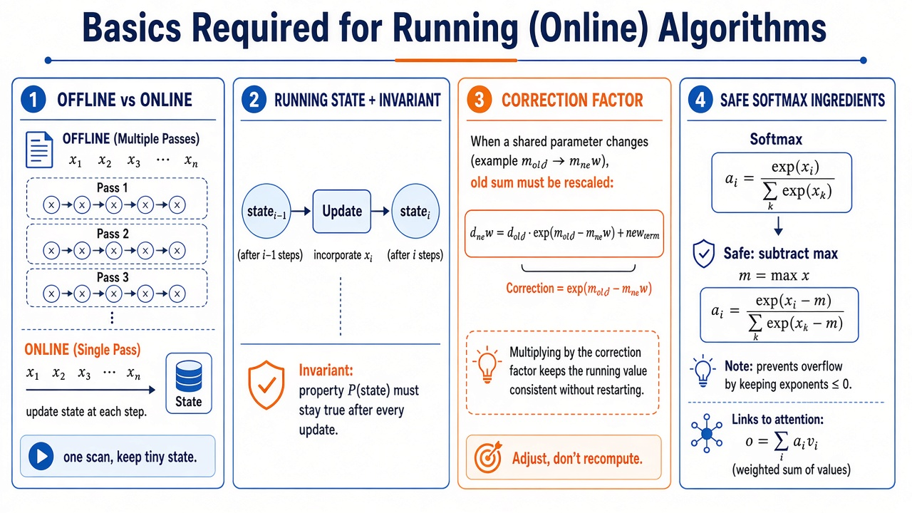
</p>

<p align="center"><em>Figure 0 — Four foundations: offline vs online, state + invariant, correction factor, safe softmax.</em></p>

### 0.1 Offline vs Online (what “running” means)

| | **Offline (multi-pass)** | **Online (running / single-pass)** |
|--|--------------------------|-------------------------------------|
| How data is used | May scan $`x_1\ldots x_N`$ **many times** | See each $`x_i`$ **once** (a stream) |
| What you store | Often the full array (or re-read it) | Only a small **running state** |
| When you finish | After all passes complete | After the last element, state is the answer |
| Example | Softmax: find max → sum exp → normalize | Softmax: update $`(m, d)`$ as each $`x_i`$ arrives |

```text
Offline:   [==== Pass 1 ====] [==== Pass 2 ====] [==== Pass 3 ====]

Online:    x1 → x2 → x3 → … → xN
            \______ update state every step ______/
```

**You need this idea:** a *running algorithm* = process the sequence in order, keep tiny memory, never require a second full scan.

---

### 0.2 Running state + update rule

At step $i-1$ you hold some state $`S_{i-1}`$.  
When $`x_i`$ arrives:

```math
S_i = \mathrm{Update}(S_{i-1},\ x_i)
```

| Example | Running state $`S`$ | Update idea |
|---------|-------------------|-------------|
| Average | $`A_{i-1}`$ | $`A_i = A_{i-1} + (x_i - A_{i-1})/i`$ |
| Top-1 max | $`m_{i-1}`$ | $`m_i = \max(m_{i-1}, x_i)`$ |
| Softmax | $`(m_{i-1}, d_{i-1})`$ | update max, then rescale + add |
| Attention out | $`o_{i-1}`$ | $`o_i = o_{i-1} + a_i v_i`$ |

**You need this idea:** design *what* to remember, then write *how* one new value changes it.

---

### 0.3 Invariant (why the update is correct)

An **invariant** is a property that must stay true after every update.

Examples:

- After $i$ steps, $`A_i`$ **equals** the true average of $`x_1\ldots x_i`$
- After $i$ steps, $`d_i = \sum_{k=1}^{i} e^{x_k - m_i}`$ (true safe-softmax denominator for the prefix)
- After $i$ steps, $`o_i = \sum_{k=1}^{i} a_k v_k`$ (true weighted sum so far)

```text
  Assume invariant true at i-1
           +  apply Update with x_i
           ↓
  Prove invariant still true at i
```

**You need this idea:** every “correction factor” exists only to **restore the invariant** when something shared (mean, max, normalizer) changes.

---

### 0.4 Correction factor (the key trick)

Sometimes state depends on a **shared parameter** (mean $`\mu`$, max $m$, denominator $d$).  
When that parameter changes, **old contributions become wrong** — you must rescale them.

Most important identity for Softmax / FlashAttention:

```math
e^{x - m_{\text{new}}}
= e^{x - m_{\text{old}}}\cdot e^{m_{\text{old}} - m_{\text{new}}}
```

So an old sum of exps updates as:

```math
d_{\text{new}} = d_{\text{old}} \cdot e^{m_{\text{old}} - m_{\text{new}}} + e^{x_i - m_{\text{new}}}
```

| Where you will see it | What changes | Correction |
|-----------------------|--------------|------------|
| Welford variance | mean $`\mu`$ | product of deviations |
| Online Softmax | max $`m`$ | multiply $`d`$ by $`e^{m_{i-1}-m_i}`$ |
| FlashAttention | $`m`$ and $`d'`$ | rescale **both** $`d'`$ and $`o'`$ |

**You need this idea:** *correction* = “fix the past so it matches the new parameter.”

---

### 0.5 Softmax from scratch (before “online”)

**Unsafe Softmax:**

```math
a_i = \frac{e^{x_i}}{\sum_{k=1}^{N} e^{x_k}}
```

Problem: large $`x_i`$ → $`e^{x_i}`$ **overflows**.

**Safe Softmax** (subtract max):

```math
m = \max_k x_k,\qquad
a_i = \frac{e^{x_i - m}}{\sum_{k=1}^{N} e^{x_k - m}}
```

Same answers (max cancels algebraically), but exponents stay ≤ 0, so no overflow.

Naive code needs **3 passes**: (1) max, (2) sum of $`e^{x-m}`$, (3) divide.  
Online Softmax fuses (1)+(2) using the correction in §0.4.

**You need this idea:** safe Softmax = Softmax + running max + exp rescale.

---

### 0.6 Accumulation (sum as a running fold)

Any sum can be written online:

```math
s_i = s_{i-1} + t_i,\qquad s_0 = 0
```

| Sum | Term $`t_i`$ | Used in |
|-----|------------|---------|
| $`\sum x_i`$ | $`x_i`$ | mean / totals |
| $`\sum e^{x_i-m}`$ | $`e^{x_i-m}`$ (with rescale) | Softmax denominator |
| $`\sum a_i v_i`$ | $`a_i v_i`$ | Attention output $`O`$ |
| $`O_i = O_{i-1} + A_i B`$ | $`A_i B`$ | [§5 Matrix accumulation](#5-matrix-accumulation-online-output) |

**You need this idea:** FlashAttention’s $`o_i = o_{i-1} + \ldots`$ is just **accumulate**, plus Softmax corrections.

---

### 0.7 Attention one-liner (what FlashAttention computes)

For one query row:

```math
x_i = q\cdot k_i^\top,\qquad
a = \mathrm{Softmax}(x),\qquad
o = \sum_{i=1}^{N} a_i\, v_i
```

| Symbol | Meaning | Basic skill needed |
|--------|---------|-------------------|
| $`q, k_i, v_i`$ | vectors | dot product |
| $`x_i`$ | score | $`q\cdot k_i`$ |
| $`a_i`$ | weight | Softmax (§0.5) |
| $`o`$ | output | accumulation (§0.6) |

**You need this idea:** FlashAttention = online safe Softmax **fused with** online accumulation of $`a_i v_i`$.

---

### 0.8 Checklist — are you ready?

Before §1–§7, you should be comfortable with:

- [ ] One pass vs many passes over an array  
- [ ] Keeping a small state and updating it with each new $`x_i`$  
- [ ] What an **invariant** is (state stays “correct” for the prefix)  
- [ ] Why Softmax subtracts $`\max x`$ (stability)  
- [ ] The identity $`e^{x-m'} = e^{x-m}\,e^{m-m'}`$  
- [ ] Writing a sum as $`s \leftarrow s + t`$ (accumulation)  
- [ ] Attention as Softmax scores × values  

If yes → start at [§1 Running average](#1-running-average-cumulative-mean).  
If Softmax/Attention feel new → re-read §0.5–§0.7, then jump to [§5](#5-matrix-accumulation-online-output) and [§6](#6-online-safe-softmax).

---

## The online pattern (use in every section below)

Every algorithm section uses the same four boxes:

1. **Multi-pass problem** — what a naive algorithm does (and why it hurts)
2. **Running state** — what we store after seeing $i-1$ elements
3. **Correction / update** — how $`x_i`$ changes that state (restore the invariant)
4. **Single-pass result** — the final recurrence (time $O(N)$, usually space $O(1)$)

---

## 1. Running Average (Cumulative Mean)

<p align="center">
  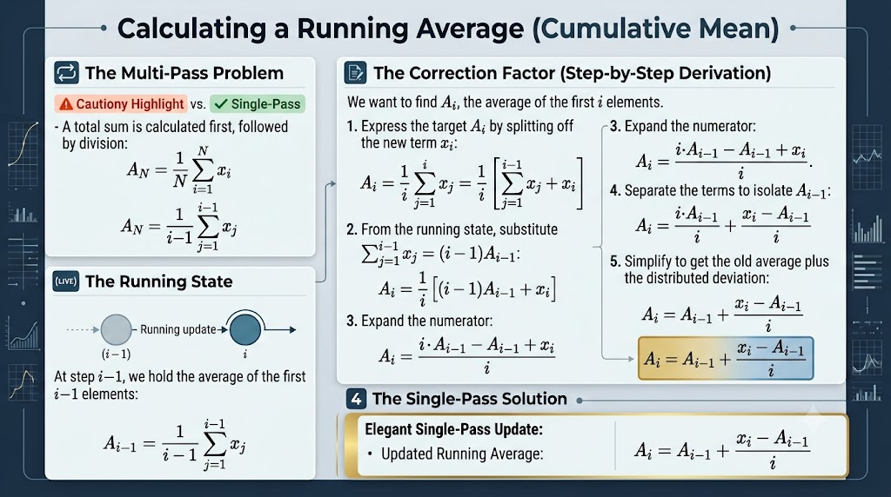
</p>

<p align="center"><em>Figure 1 — From a full-sum average to a one-line online update.</em></p>

### Multi-pass problem

To get the average you normally need the whole sum first:

```math
A_N = \frac{1}{N}\sum_{i=1}^{N} x_i
```

That means either buffer all $`x_i`$, or make a dedicated sum pass before you can report $`A_N`$.

### Running state

After $i-1$ values we only keep the current average:

```math
A_{i-1} = \frac{1}{i-1}\sum_{j=1}^{i-1} x_j
\quad\Longleftrightarrow\quad
\sum_{j=1}^{i-1} x_j = (i-1)\,A_{i-1}
```

### Correction (derivation sketch)

```math
A_i
= \frac{1}{i}\Big[(i-1)A_{i-1} + x_i\Big]
= A_{i-1} + \frac{x_i - A_{i-1}}{i}
```

Intuition: take the old average and add the new point’s **deviation**, spread over $i$ samples.

### Single-pass result

```math
A_i = A_{i-1} + \frac{x_i - A_{i-1}}{i}
```

**Takeaway:** this is the template for every later algorithm — *old state + scaled correction*.

---

## 2. Welford’s Online Variance

<p align="center">
  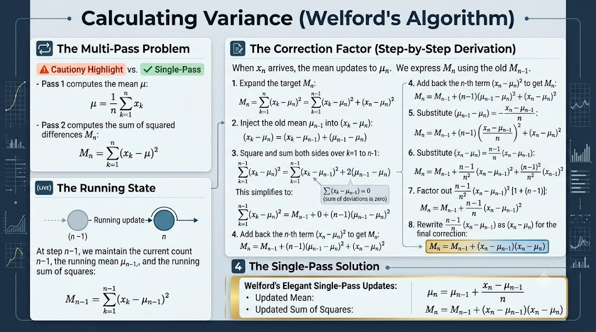
</p>

<p align="center"><em>Figure 2 — Two-pass variance → Welford single-pass updates for $`\mu`$ and $M$.</em></p>

### Multi-pass problem

Classic variance needs two scans:

| Pass | Formula |
|------|---------|
| 1 — mean | $`\displaystyle \mu = \frac{1}{n}\sum_{k=1}^{n} x_k`$ |
| 2 — sum of squares | $`\displaystyle M_n = \sum_{k=1}^{n}(x_k - \mu)^2`$ |

You must store or re-stream every $`x_k`$.

### Running state (after $n-1$ points)

- count: $n-1$
- mean: $`\mu_{n-1}`$
- sum of squared deviations: $`M_{n-1} = \sum_{k=1}^{n-1}(x_k - \mu_{n-1})^2`$

### Correction

When $`x_n`$ arrives, the mean moves, so every old $`(x_k - \mu)`$ is wrong. After expanding and simplifying, the net change collapses to a product of two deviations (old mean vs new mean):

```math
\mu_n = \mu_{n-1} + \frac{x_n - \mu_{n-1}}{n}
```

```math
M_n = M_{n-1} + (x_n - \mu_{n-1})(x_n - \mu_n)
```

### Single-pass result

```math
\begin{aligned}
\mu_n &= \mu_{n-1} + \frac{x_n - \mu_{n-1}}{n} \\
M_n &= M_{n-1} + (x_n - \mu_{n-1})(x_n - \mu_n)
\end{aligned}
```

**Takeaway:** when a summary statistic depends on another running quantity (here $`\mu`$), the update must **correct** the dependent state — same idea as rescaling the softmax denominator when the max changes.

---

## 3. Maximum Subarray Sum — Kadane’s Algorithm

<p align="center">
  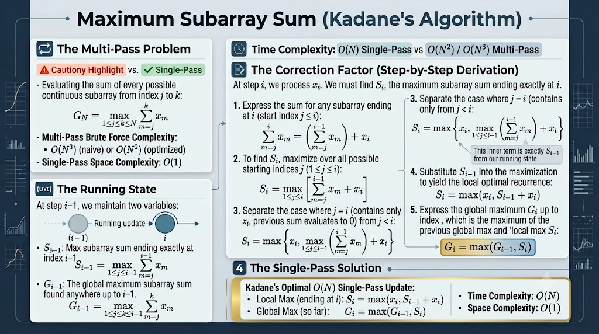
</p>

<p align="center"><em>Figure 3 — Brute-force all subarrays → $O(N)$ local/global running max.</em></p>

### Multi-pass problem

Find the contiguous subarray with largest sum:

```math
G_N = \max_{1\le j\le k\le N}\sum_{m=j}^{k} x_m
```

- Naive: $`O(N^3)`$
- Better prefix tricks: still $`O(N^2)`$

### Running state

| Symbol | Meaning |
|--------|---------|
| $`S_{i-1}`$ | best sum among subarrays **ending at** $`i-1`$ |
| $`G_{i-1}`$ | best sum among **all** subarrays in the prefix |

### Correction

A subarray ending at $i$ either starts fresh at $i$, or extends the best ending at $i-1$:

```math
S_i = \max(x_i,\ S_{i-1} + x_i),\qquad
G_i = \max(G_{i-1},\ S_i)
```

### Single-pass result

```math
\begin{aligned}
S_i &= \max(x_i,\ S_{i-1}+x_i) \\
G_i &= \max(G_{i-1},\ S_i)
\end{aligned}

\qquad
\text{Time }O(N),\ \text{Space }O(1)
```

**Takeaway:** two coupled running values (local + global) already feel like Softmax’s $(m, d)$ pair.

---

## 4. First & Second Maximum in One Pass

<p align="center">
  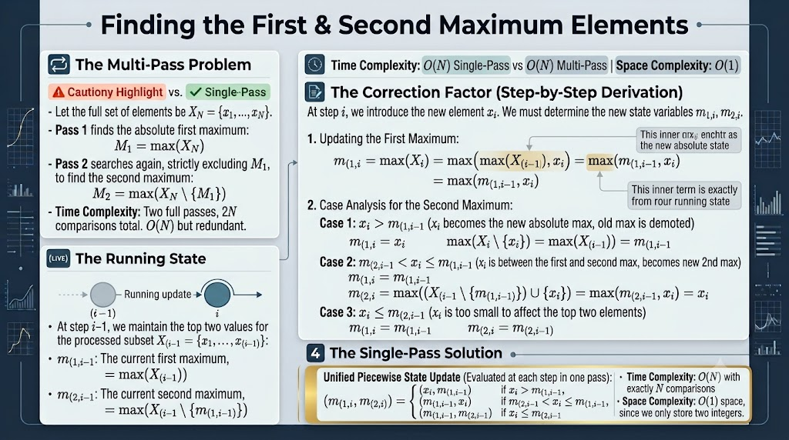
</p>

<p align="center"><em>Figure 4 — Two-pass top-2 → one-pass piecewise update of $`(m_1, m_2)`$.</em></p>

### Multi-pass problem

1. Pass 1: $`M_1 = \max(X)`$
2. Pass 2: $`M_2 = \max(X\setminus\{M_1\})`$

Still $O(N)$, but **two full scans** and about $2N$ comparisons.

### Running state

For the prefix $`X_{(i-1)} = \{x_1,\ldots,x_{i-1}\}`$ keep:

- $`m_{(1,i-1)}`$ — current first max  
- $`m_{(2,i-1)}`$ — current second max  

### Correction (three cases for $`x_i`$)

| Case | Condition | New $`(m_1,\ m_2)`$ |
|------|-----------|-------------------|
| 1 | $`x_i > m_{(1,i-1)}`$ | $`(x_i,\ m_{(1,i-1)})`$ — old max demoted |
| 2 | $`m_{(2,i-1)} < x_i \le m_{(1,i-1)}`$ | $`(m_{(1,i-1)},\ x_i)`$ |
| 3 | $`x_i \le m_{(2,i-1)}`$ | unchanged |

### Single-pass result

```math
(m_{(1,i)}, m_{(2,i)}) =
\begin{cases}
(x_i,\ m_{(1,i-1)}) & x_i > m_{(1,i-1)} \\
(m_{(1,i-1)},\ x_i) & m_{(2,i-1)} < x_i \le m_{(1,i-1)} \\
(m_{(1,i-1)},\ m_{(2,i-1)}) & x_i \le m_{(2,i-1)}
\end{cases}
```

**Takeaway:** maintaining a **running maximum** (and reacting when it changes) is exactly the skill Online Softmax needs.

---

## 5. Matrix Accumulation (Online Output)

Before Softmax / Attention, we need one building block: **how matrix multiplication is really a sum**, and how any sum becomes a **running formula**.

We do **not** start from $`O_i = O_{i-1} + \ldots`$.  
We **derive** that formula from the definition of $AB$.

<p align="center">
  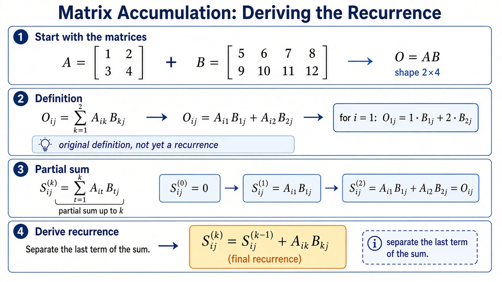
</p>

<p align="center"><em>Figure 5 — Matrix accumulation (visual). Derivation is written out below.</em></p>

---

### 5.1 Original matrices

```math
A = \begin{bmatrix} 1 & 2 \\ 3 & 4 \end{bmatrix}
```

```math
B = \begin{bmatrix} 5 & 6 & 7 & 8 \\ 9 & 10 & 11 & 12 \end{bmatrix}
```

Plain-text form (always readable if math fails):

```text
A = [[1, 2],
     [3, 4]]          # shape 2x2

B = [[5,  6,  7,  8],
     [9, 10, 11, 12]] # shape 2x4

O = A B               # shape 2x4
```

Goal: understand `O = AB` (shape 2×4), then turn it into a running update.

---

### 5.2 Start from the definition (not from a running formula)

By definition of matrix multiplication, each entry is a **dot product**:

```math
O[i,j] = \sum_{k=1}^{2} A[i,k]\, B[k,j]
```

So the **whole $i$-th output row** is:

```math
O[i,:]
= \sum_{k=1}^{2} A[i,k]\cdot B[k,:]
```

In words:

> One output row = **sum of (scalar from $A$) × (one row of $B$)**.

That sum is the key. A running algorithm is just this sum written step by step.

---

### 5.3 Expand the first output row as a sum

Focus on row $i=1$ of $A$:

```math
A[1,:] = \begin{bmatrix} 1 & 2 \end{bmatrix}
```

Rows of B:

```math
B[1,:] = \begin{bmatrix} 5 & 6 & 7 & 8 \end{bmatrix}
```

```math
B[2,:] = \begin{bmatrix} 9 & 10 & 11 & 12 \end{bmatrix}
```

Apply the definition (one line at a time):

```math
O[1,:] = A[1,1] \cdot B[1,:] + A[1,2] \cdot B[2,:]
```

```math
O[1,:] = 1 \cdot \begin{bmatrix} 5 & 6 & 7 & 8 \end{bmatrix} + 2 \cdot \begin{bmatrix} 9 & 10 & 11 & 12 \end{bmatrix}
```

```math
O[1,:] = \begin{bmatrix} 5 & 6 & 7 & 8 \end{bmatrix} + \begin{bmatrix} 18 & 20 & 22 & 24 \end{bmatrix}
```

```math
O[1,:] = \begin{bmatrix} 23 & 26 & 29 & 32 \end{bmatrix}
```

```text
# same numbers without LaTeX
O[1,:] = 1*[5,6,7,8] + 2*[9,10,11,12]
       = [5,6,7,8] + [18,20,22,24]
       = [23, 26, 29, 32]
```

So far we only used the **definition** of $AB$. No running formula yet.

---

### 5.4 Turn any sum into a running update

In general, a sum

```math
S = t_1 + t_2 + \cdots + t_m
```

can always be computed online:

```math
\begin{aligned}
S_0 &= 0 \\
S_1 &= S_0 + t_1 \\
S_2 &= S_1 + t_2 \\
&\;\;\vdots \\
S_m &= S_{m-1} + t_m
\end{aligned}
```

One line:

```math
S_k = S_{k-1} + t_k,\qquad S_0 = 0
```

This is the **only** new idea. Everything below is this pattern with a concrete $`t_k`$.

---

### 5.5 Derive the running formula for one output row

For output row 1, the terms in the sum were:

```math
t_1 = A[1,1] \cdot B[1,:] = 1 \cdot \begin{bmatrix} 5 & 6 & 7 & 8 \end{bmatrix}
```

```math
t_2 = A[1,2] \cdot B[2,:] = 2 \cdot \begin{bmatrix} 9 & 10 & 11 & 12 \end{bmatrix}
```

Plug into $`S_k = S_{k-1} + t_k`$:

**Init**

```math
O_0 = \begin{bmatrix} 0 & 0 & 0 & 0 \end{bmatrix}
```

**Step k=1** — add first contribution

```math
O_1 = O_0 + A[1,1] \cdot B[1,:] = \begin{bmatrix} 5 & 6 & 7 & 8 \end{bmatrix}
```

**Step k=2** — add second contribution

```math
O_2 = O_1 + A[1,2] \cdot B[2,:] = \begin{bmatrix} 23 & 26 & 29 & 32 \end{bmatrix}
```

```text
O_0 = [0, 0, 0, 0]
O_1 = O_0 + 1*[5,6,7,8]     = [5, 6, 7, 8]
O_2 = O_1 + 2*[9,10,11,12]  = [23, 26, 29, 32]
```

`O_2` matches `O[1,:]` from §5.3. So the running process is correct.

**General running rule** (for a fixed output row `i`):

```math
O_k = O_{k-1} + A[i,k] \cdot B[k,:], \quad O_0 = 0
```

This is **derived**, not assumed:

```math
O[i,:] = \sum_k A[i,k] B[k,:]
\quad \Longrightarrow \quad
O_k = O_{k-1} + A[i,k] B[k,:]
```

(definition of `AB` → running form of that sum)

---

### 5.6 Same derivation for the second output row

```math
O[2,:] = 3 \cdot \begin{bmatrix} 5 & 6 & 7 & 8 \end{bmatrix} + 4 \cdot \begin{bmatrix} 9 & 10 & 11 & 12 \end{bmatrix}
```

```math
O[2,:] = \begin{bmatrix} 51 & 58 & 65 & 72 \end{bmatrix}
```

Running view:

```text
O_0 = [0, 0, 0, 0]
O_1 = O_0 + 3*[5,6,7,8]     = [15, 18, 21, 24]
O_2 = O_1 + 4*[9,10,11,12]  = [51, 58, 65, 72]
```

---

### 5.7 Full matrix $O = AB$

Stack the finished rows:

```math
O = AB =
\begin{bmatrix}
23 & 26 & 29 & 32 \\
51 & 58 & 65 & 72
\end{bmatrix}
```

---

### 5.8 Optional view: whole row of $A$ at once

You can also group the inner sum as one row×matrix product:

```math
A_1 B = \begin{bmatrix} 1 & 2 \end{bmatrix}
\begin{bmatrix} 5 & 6 & 7 & 8 \\ 9 & 10 & 11 & 12 \end{bmatrix}
= \begin{bmatrix} 23 & 26 & 29 & 32 \end{bmatrix}
```

Then, starting from zero:

```math
O_1 = O_0 + A_1 B
```

is just the same sum, with **all $k$ terms added in one shot**.  
§5.5 is the clearer “how it runs” view (add one $k$ at a time).

---

### 5.9 Why this matters for Attention / FlashAttention

Attention output for one query is also a sum:

```math
o = \sum_{i=1}^{N} a_i\, v_i
```

Same rewrite as §5.4–§5.5:

```math
\begin{aligned}
o_0 &= 0 \\
o_1 &= o_0 + a_1 v_1 \\
o_2 &= o_1 + a_2 v_2 \\
&\;\;\vdots \\
o_N &= o_{N-1} + a_N v_N
\end{aligned}
```

```math
o_i = o_{i-1} + a_i\, v_i,\qquad o_0 = 0
```

| Matrix accumulation (§5.5) | Attention |
|----------------------------|-----------|
| term $`t_k = A[i,k]\cdot B[k,:]`$ | term $`t_i = a_i\, v_i`$ |
| $`O_k = O_{k-1} + t_k`$ | $`o_i = o_{i-1} + t_i`$ |
| reduce over inner index $`k`$ | reduce over sequence index $`i`$ |

**Takeaway:** the running formula is only “sum → fold.” FlashAttention streams $`a_i v_i`$ into $o$ this way; Softmax’s $(m,d')$ corrections keep the $`a_i`$ correct online.

---

## 6. Online Safe Softmax

Safe softmax subtracts the global max before `exp` so large logits do not overflow:

```math
a_i = \frac{e^{x_i - m_N}}{\sum_{k=1}^{N} e^{x_k - m_N}},\qquad m_N = \max_k x_k
```

Naive code → **3 passes**. Online code fuses the first two.

### 6.1 Whiteboard derivation (step i-1 → i)

<p align="center">
  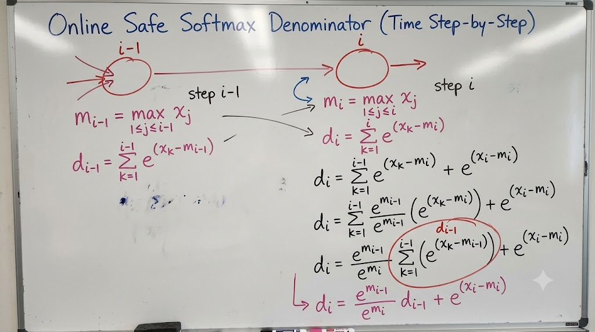
</p>

<p align="center"><em>Figure 6a — Hand derivation of the denominator correction.</em></p>

**State at $i-1$:**

```math
m_{i-1} = \max_{j\le i-1} x_j,\qquad
d_{i-1} = \sum_{k=1}^{i-1} e^{x_k - m_{i-1}}
```

**Goal at $i$:** $`m_i = \max(m_{i-1}, x_i)`$ and $`d_i = \sum_{k=1}^{i} e^{x_k - m_i}`$.

Rewrite old terms with the identity $`x_k - m_i = (x_k - m_{i-1}) + (m_{i-1} - m_i)`$:

```math
d_i
= e^{m_{i-1}-m_i}\,d_{i-1} + e^{x_i - m_i}
```

If $`m_i = m_{i-1}`$, the factor is $1$ (no rescale). If $`m_i = x_i > m_{i-1}`$, every old contribution is multiplied by $`e^{m_{i-1}-m_i} < 1`$.

---

### 6.2 Infographic: full online safe softmax

<p align="center">
  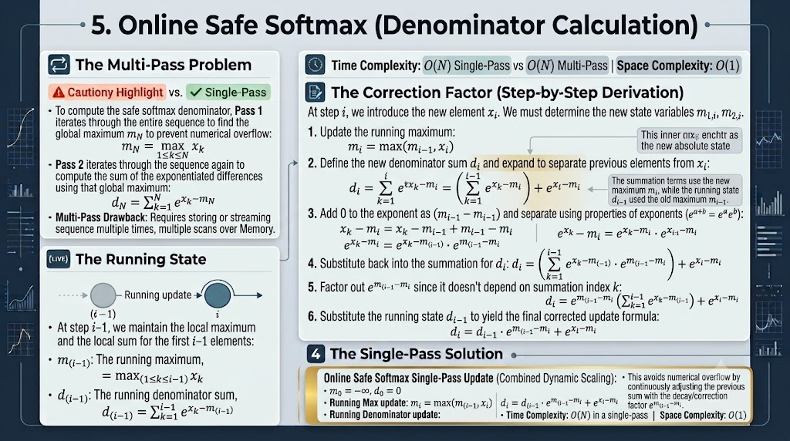
</p>

<p align="center"><em>Figure 6b — Multi-pass vs single-pass safe softmax denominator.</em></p>

| | Multi-pass | Online |
|--|------------|--------|
| Pass 1 | find $`m_N`$ | — |
| Pass 2 | sum $`e^{x_k-m_N}`$ | fused with max |
| Init | — | $`m_0=-\infty`$, $`d_0=0`$ |
| Update | — | $`m_i=\max(m_{i-1},x_i)`$<br>$`d_i=d_{i-1}e^{m_{i-1}-m_i}+e^{x_i-m_i}`$ |
| Complexity | $`O(N)`$ time, **2+ scans** | $`O(N)`$ time, **1 scan**, $`O(1)`$ space |

---

### 6.3 Offline 3-pass Softmax (baseline)

<p align="center">
  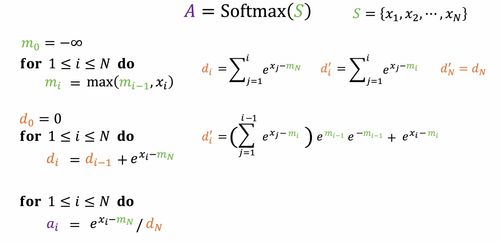
</p>

<p align="center"><em>Figure 6c — Left: classic 3-pass Softmax. Right: why $`d'_i`$ can track the true denominator online.</em></p>

```text
# Pass 1 — global max
m_0 = -∞
for i = 1 .. N:
    m_i = max(m_{i-1}, x_i)          # result: m_N

# Pass 2 — denominator with fixed m_N
d_0 = 0
for i = 1 .. N:
    d_i = d_{i-1} + exp(x_i - m_N)   # result: d_N

# Pass 3 — normalize
for i = 1 .. N:
    a_i = exp(x_i - m_N) / d_N
```

Online view uses a **local** sum $`d'_i = \sum_{j=1}^{i} e^{x_j - m_i}`$. At the end $`d'_N = d_N`$, and:

```math
d'_i = d'_{i-1}\,e^{m_{i-1}-m_i} + e^{x_i-m_i}
```

---

### 6.4 Same story, another angle

<p align="center">
  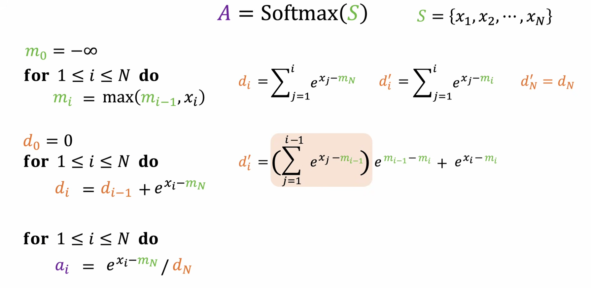
</p>

<p align="center"><em>Figure 6d — Safe Softmax passes (left) and the online recurrence for $`d'_i`$ (right).</em></p>

Key definitions:

- $`d_i`$ — partial sum using the **final** global max $`m_N`$ (needs a future value)
- $`d'_i`$ — partial sum using the **current** max $`m_i`$ (computeable online)
- At $i = N$: $`d'_N = d_N`$ ✓

---

### 6.5 Result: 3-pass → 2-pass Softmax

<p align="center">
  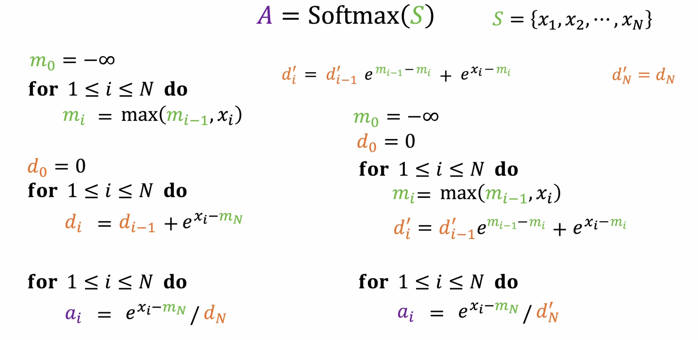
</p>

<p align="center"><em>Figure 6e — Fusing find-max and sum-exp into one loop; only normalize remains as a second pass.</em></p>

**Online Softmax (2 passes):**

```text
# Fused pass — max + running denominator
m_0 = -∞;  d'_0 = 0
for i = 1 .. N:
    m_i  = max(m_{i-1}, x_i)
    d'_i = d'_{i-1} * exp(m_{i-1} - m_i) + exp(x_i - m_i)

# Normalize pass
for i = 1 .. N:
    a_i = exp(x_i - m_N) / d'_N
```

**Takeaway:** loop fusion already cut one full memory scan. FlashAttention goes further and folds $AV$ into the same stream.

---

## 7. FlashAttention — Fusing Softmax and $AV$

For one query row:

```math
S = QK^\top,\quad
A = \mathrm{Softmax}(S),\quad
O = AV
```

with scores $`x_i = q\,k_i^\top`$. We never want to materialize the full $`N\times N`$ matrix $A$.  
The output product $O = AV$ is exactly the **matrix accumulation** from §5, with $`a_i`$ playing the role of $`A_i`$ and $`v_i`$ the role of a row of $B$.

### 7.1 Attention + online softmax (setup)

<p align="center">
  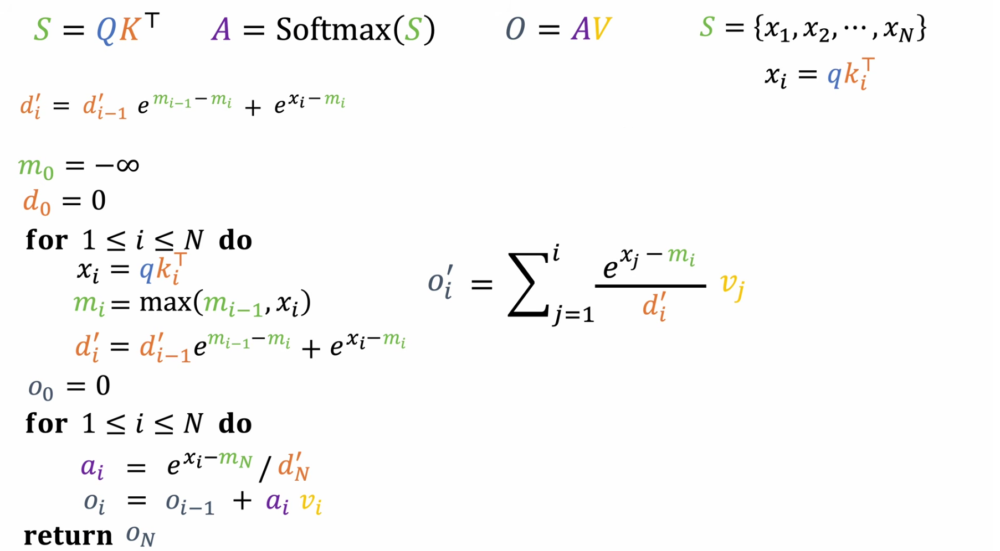
</p>

<p align="center"><em>Figure 7a — $`S=QK^\top`$, $`A=\mathrm{Softmax}(S)`$, $O=AV$, plus online $(m,d')$ updates.</em></p>

Initializations: $`m_0 = -\infty`$, $`d'_0 = 0`$, and later $`o'_0 = 0`$.

---

### 7.2 Two-pass attention with online stats

<p align="center">
  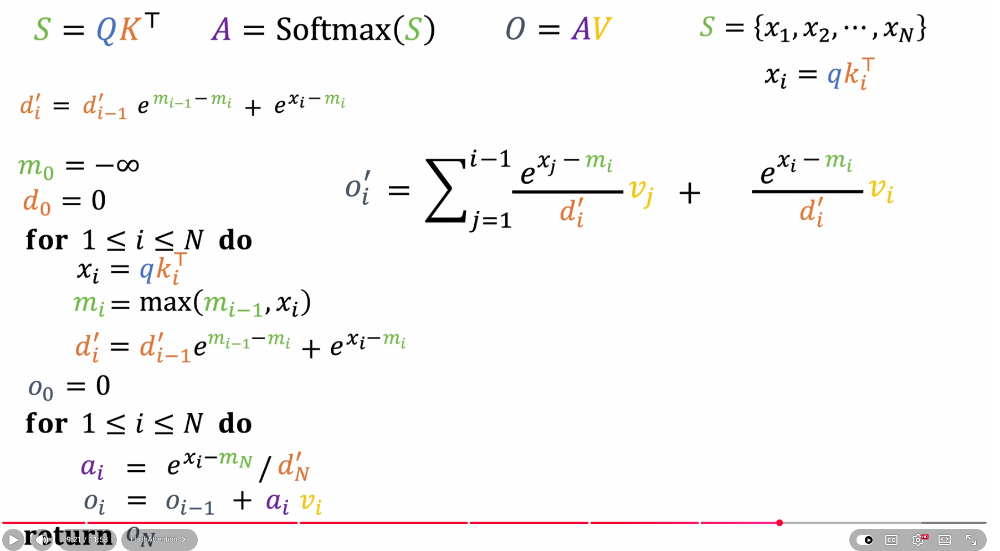
</p>

<p align="center"><em>Figure 7b — Pass 1 collects $`(m_N, d'_N)`$; Pass 2 builds $`o_N = \sum a_i v_i`$.</em></p>

```text
# Pass 1 — scores + running max/denominator
m_0 = -∞;  d'_0 = 0
for i = 1 .. N:
    x_i  = q · k_iᵀ
    m_i  = max(m_{i-1}, x_i)
    d'_i = d'_{i-1} * exp(m_{i-1} - m_i) + exp(x_i - m_i)

# Pass 2 — weighted sum of values
o_0 = 0
for i = 1 .. N:
    a_i = exp(x_i - m_N) / d'_N
    o_i = o_{i-1} + a_i * v_i
return o_N
```

Still two passes over $V$ (or you must buffer scores). FlashAttention’s insight: also keep a **running output** and rescale it.

---

### 7.3 Why the output needs a correction factor

<p align="center">
  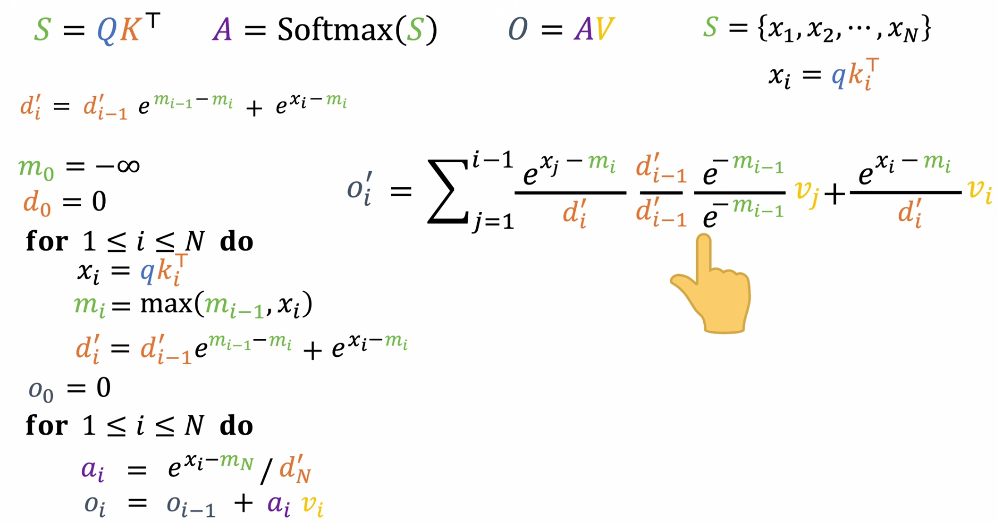
</p>

<p align="center"><em>Figure 7c — Algebra that inserts the rescale so old $`v_j`$ stay correct under new $`(m_i, d'_i)`$.</em></p>

Partial output after $i$ tokens (normalized with **current** stats):

```math
o'_i = \sum_{j=1}^{i}\frac{e^{x_j - m_i}}{d'_i}\,v_j
```

When $(m,d')$ change, previous weights must be multiplied by the same correction that was applied to the denominator.

---

### 7.4 Clean recurrence for o'_i

<p align="center">
  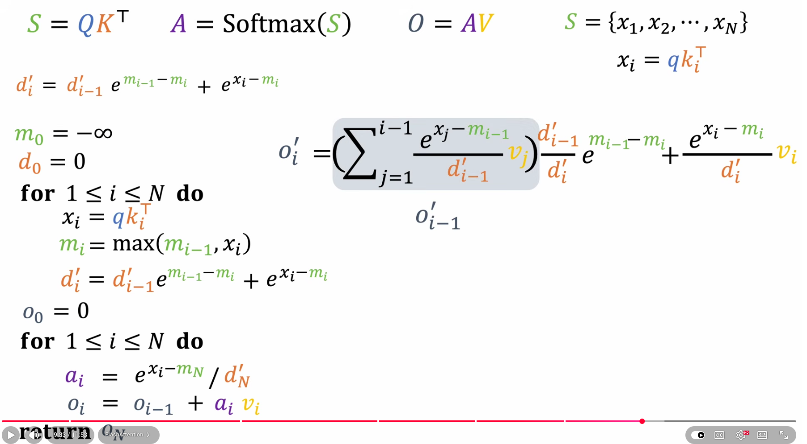
</p>

<p align="center"><em>Figure 7d — Highlighted $`o'_{i-1}`$ term and the closed-form online update.</em></p>

```math
o'_i
=
o'_{i-1}\cdot\frac{d'_{i-1}}{d'_i}\,e^{m_{i-1}-m_i}
\;+\;
\frac{e^{x_i-m_i}}{d'_i}\,v_i
```

Two pieces:

1. **Rescale** everything already accumulated ($`o'_{i-1}`$)
2. **Add** the new contribution from $`v_i`$

---

### 7.5 Fully fused single-pass FlashAttention update

<p align="center">
  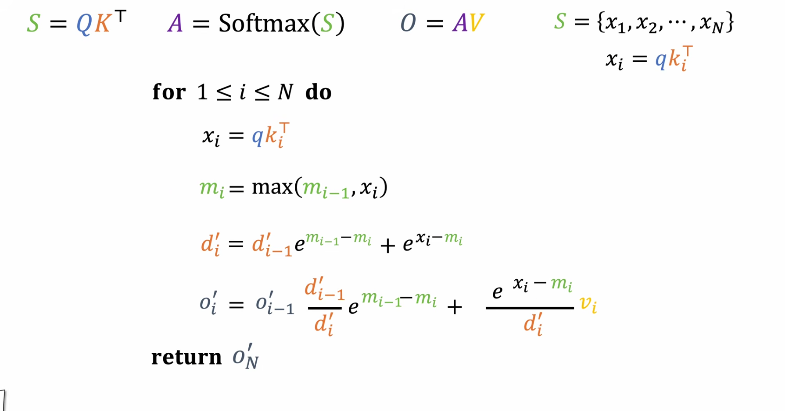
</p>

<p align="center"><em>Figure 7e — One loop updates $m$, $d'$, and $o'$ together; return $`o'_N`$.</em></p>

```text
m_0 = -∞;  d'_0 = 0;  o'_0 = 0

for i = 1 .. N:
    x_i  = q · k_iᵀ
    m_i  = max(m_{i-1}, x_i)
    d'_i = d'_{i-1} * exp(m_{i-1} - m_i) + exp(x_i - m_i)
    o'_i = o'_{i-1} * (d'_{i-1} / d'_i) * exp(m_{i-1} - m_i)
         + (exp(x_i - m_i) / d'_i) * v_i

return o'_N
```

| Property | Standard attention | Fused online update |
|----------|--------------------|---------------------|
| Store full $`A`$ | Yes ($`N\times N`$) | No |
| Passes over $`K,V`$ | Several | **One** (per tile / stream) |
| Extra state / query | — | Only $`(m,\ d',\ o')`$ |
| Numerical stability | Needs global max | Running max + rescale |

This is the algorithmic heart of **FlashAttention-style loop fusion** (the production kernels also tile for GPU SRAM; the math above is the online core).

---

## Cheatsheet

| Topic | Running state | Correction idea |
|-------|---------------|-----------------|
| Mean | $`A_{i-1}`$ | add $`(x_i-A_{i-1})/i`$ |
| Variance | $`(\mu_{n-1}, M_{n-1})`$ | update $`\mu`$, then $`M`$ with $`(x-\mu_{\text{old}})(x-\mu_{\text{new}})`$ |
| Kadane | $`(S_{i-1}, G_{i-1})`$ | extend or restart local max |
| Top-2 | $`(m_1, m_2)`$ | case split on where $`x_i`$ sits |
| Matrix accum. | $`O_{i-1}`$ | $`O_i = O_{i-1} + A_i B`$ |
| Softmax | $`(m_{i-1}, d_{i-1})`$ | multiply $`d`$ by $`e^{m_{i-1}-m_i}`$ |
| Attention | $`(m, d', o')`$ | rescale **both** $`d'`$ and $`o'`$, then add new $`v_i`$ |
